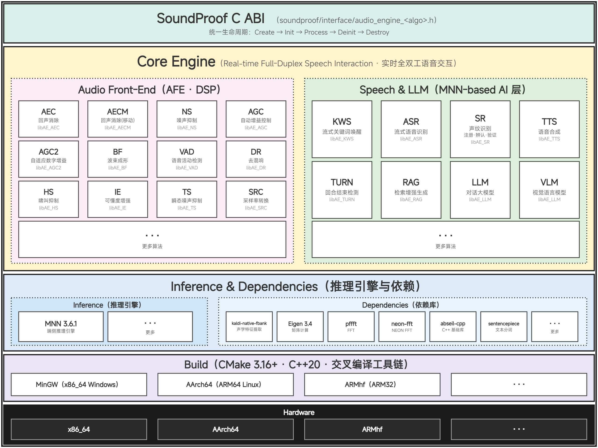

# SoundProof

SoundProof is a full-duplex voice interaction stack that runs in real time on a streaming audio pipeline. Its audio front-end (AFE) handles echo cancellation, noise suppression, gain control, beamforming, VAD and dereverberation; the speech/LLM layer adds keyword spotting, ASR, speaker recognition, turn detection, TTS, RAG and chat/VLM. Everything is exposed as a pure C ABI, with each algorithm built as a static library named `libAE_<ALGO>` (CMake target `AE_<ALGO>`).



## Algorithms

| Library | Algorithm | Source |
|---|---|---|
| libAE_VAD | Voice activity detection | [core/voice_activity_detection/](soundproof/core/voice_activity_detection/) |
| libAE_SRC | Sample rate conversion | [core/sample_rate_conversion/](soundproof/core/sample_rate_conversion/) |
| libAE_NS | Noise suppression | [core/noise_suppressor/](soundproof/core/noise_suppressor/) |
| libAE_AGC | Automatic gain control | [core/automatic_gain_control/](soundproof/core/automatic_gain_control/) |
| libAE_AGC2 | Adaptive digital gain control | [core/automatic_gain_control2/](soundproof/core/automatic_gain_control2/) |
| libAE_AECM | Acoustic echo cancellation (mobile) | [core/acoustic_echo_cancellation_mobile/](soundproof/core/acoustic_echo_cancellation_mobile/) |
| libAE_AEC | Acoustic echo cancellation | [core/acoustic_echo_cancellation3/](soundproof/core/acoustic_echo_cancellation3/) |
| libAE_BF | Beamforming | [core/beamforming/](soundproof/core/beamforming/) |
| libAE_HS | Howling suppression | [core/howling_suppressor/](soundproof/core/howling_suppressor/) |
| libAE_IE | Intelligibility enhancement | [core/intelligibility_enhancer/](soundproof/core/intelligibility_enhancer/) |
| libAE_TS | Transient noise suppression | [core/transient_suppressor/](soundproof/core/transient_suppressor/) |
| libAE_DR | Dereverberation | [core/dereverberation/](soundproof/core/dereverberation/) |
| libAE_KWS | Streaming keyword spotting | [core/keywords_spotting/](soundproof/core/keywords_spotting/) |
| libAE_ASR | Streaming speech recognition | [core/speech_recognition/](soundproof/core/speech_recognition/) |
| libAE_SR | Speaker recognition (enrollment / identification / verification) | [core/speaker_recognition/](soundproof/core/speaker_recognition/) |
| libAE_TTS | Text-to-speech | [core/text_to_speech/](soundproof/core/text_to_speech/) |
| libAE_TURN | End-of-turn detection | [core/turn_detection/](soundproof/core/turn_detection/) |
| libAE_RAG | Text embeddings for retrieval-augmented generation | [core/retrieval_augmented_generation/](soundproof/core/retrieval_augmented_generation/) |
| libAE_LLM | Chat / vision-language model | [core/llm/](soundproof/core/llm/) |

## Build

Requirements: CMake 3.16+, a C++20 compiler. Toolchain files for MinGW, aarch64 and armhf are in `toolchains/`.

```bash
# DSP only (default)
cmake -S . -B build -G "MinGW Makefiles" \
      -DCMAKE_TOOLCHAIN_FILE=toolchains/x86_64-windows.cmake
cmake --build build -j

# Add MNN algorithms (KWS, ASR, SR, TTS, TURN, Silero VAD)
cmake -S . -B build -G "MinGW Makefiles" \
      -DCMAKE_TOOLCHAIN_FILE=toolchains/x86_64-windows.cmake -DWITH_MNN=ON
cmake --build build -j

# Add MNN-LLM (RAG)
cmake -S . -B build -G "MinGW Makefiles" \
      -DCMAKE_TOOLCHAIN_FILE=toolchains/x86_64-windows.cmake -DWITH_MNN_LLM=ON
cmake --build build -j

# Add MNN vision (LLM / VLM)
cmake -S . -B build -G "MinGW Makefiles" \
      -DCMAKE_TOOLCHAIN_FILE=toolchains/x86_64-windows.cmake -DWITH_MNN_VISION=ON
cmake --build build -j
```

- `WITH_MNN_LLM` implies `WITH_MNN`; `WITH_MNN_VISION` implies `WITH_MNN_LLM`.
- Each module is defined in `cmake/<algo>.cmake` and can be enabled or disabled with `-DBUILD_AE_<ALGO>=ON/OFF`.
- MNN builds are memory-heavy on MinGW; use `-j 1` / `-j 2` if needed.
- On other platforms omit `-G` and the toolchain file.

## Models

Model weights are not tracked in this repository. Fetch them with:

```bash
cd models
./download.sh
```

Tests that need a model print `SKIP` and succeed when the assets are missing.

## Tests

```bash
ctest --test-dir build --output-on-failure
```

## C API

Include `soundproof/interface/audio_engine_<algo>.h` and link the corresponding `libAE_<ALGO>` library. Every algorithm follows the same lifecycle:

```c
XxxHandle handle = AudioEngine_Xxx_Create();
AudioEngine_Xxx_Init(handle, &init_config);
AudioEngine_Xxx_Process(handle, &input, &result);
AudioEngine_Xxx_Deinit(handle);
AudioEngine_Xxx_Destroy(handle);
```

## License

Apache-2.0.

## Dependencies

- [abseil-cpp 20240116.2](https://github.com/abseil/abseil-cpp)
- [neon-fft v0.1.0](https://github.com/Ryuk17/neon-fft)
- [pffft](https://bitbucket.org/jpommier/pffft)
- [Eigen 3.4.0](https://gitlab.com/libeigen/eigen)
- [kaldi-native-fbank 1.21.1](https://github.com/csukuangfj/kaldi-native-fbank)
- [simple-sentencepiece 0.7](https://github.com/pkufool/simple-sentencepiece)
- [MNN 3.6.1](https://github.com/alibaba/MNN)
