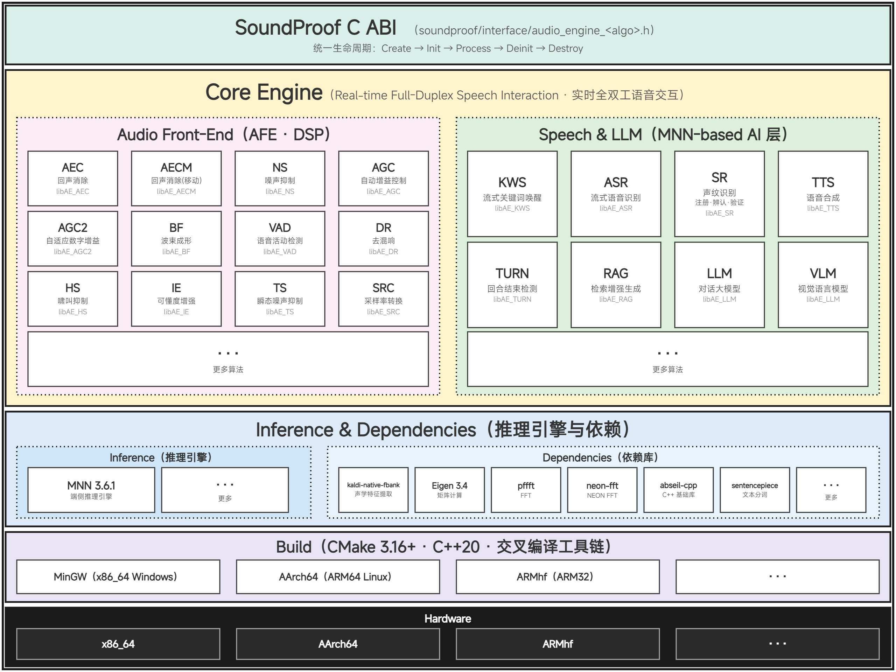

# SoundProof

SoundProof 是一套运行在实时流式音频管线上的全双工语音交互栈。音频前端（AFE）负责回声消除、噪声抑制、增益控制、波束成形、VAD 与去混响；语音/LLM 层提供关键词唤醒、ASR、说话人识别、轮次检测、TTS、RAG 与对话/VLM。所有能力以纯 C ABI 对外提供，每个算法编译为静态库 `libAE_<ALGO>`（CMake 目标 `AE_<ALGO>`）。



## 算法模块

| 模块 | 算法 | 源码 |
|---|---|---|
| libAE_VAD | 语音活动检测 | [core/voice_activity_detection/](soundproof/core/voice_activity_detection/) |
| libAE_SRC | 采样率转换 | [core/sample_rate_conversion/](soundproof/core/sample_rate_conversion/) |
| libAE_NS | 噪声抑制 | [core/noise_suppressor/](soundproof/core/noise_suppressor/) |
| libAE_AGC | 自动增益控制 | [core/automatic_gain_control/](soundproof/core/automatic_gain_control/) |
| libAE_AGC2 | 自适应数字增益控制 | [core/automatic_gain_control2/](soundproof/core/automatic_gain_control2/) |
| libAE_AECM | 声学回声消除-移动端 | [core/acoustic_echo_cancellation_mobile/](soundproof/core/acoustic_echo_cancellation_mobile/) |
| libAE_AEC | 声学回声消除 | [core/acoustic_echo_cancellation3/](soundproof/core/acoustic_echo_cancellation3/) |
| libAE_BF | 波束成形 | [core/beamforming/](soundproof/core/beamforming/) |
| libAE_HS | 啸叫抑制 | [core/howling_suppressor/](soundproof/core/howling_suppressor/) |
| libAE_IE | 语音可懂度增强 | [core/intelligibility_enhancer/](soundproof/core/intelligibility_enhancer/) |
| libAE_TS | 瞬态噪声抑制 | [core/transient_suppressor/](soundproof/core/transient_suppressor/) |
| libAE_DR | 去混响 | [core/dereverberation/](soundproof/core/dereverberation/) |
| libAE_KWS | 流式关键词唤醒 | [core/keywords_spotting/](soundproof/core/keywords_spotting/) |
| libAE_ASR | 流式语音识别 | [core/speech_recognition/](soundproof/core/speech_recognition/) |
| libAE_SR | 说话人识别（注册 / 识别 / 验证） | [core/speaker_recognition/](soundproof/core/speaker_recognition/) |
| libAE_TTS | 语音合成 | [core/text_to_speech/](soundproof/core/text_to_speech/) |
| libAE_TURN | 轮次检测 | [core/turn_detection/](soundproof/core/turn_detection/) |
| libAE_RAG | RAG 文本向量化 | [core/retrieval_augmented_generation/](soundproof/core/retrieval_augmented_generation/) |
| libAE_LLM | 对话 / 视觉语言模型 | [core/llm/](soundproof/core/llm/) |

## 编译

依赖：CMake 3.16+、C++20 编译器。MinGW、aarch64、armhf 的工具链文件位于 `toolchains/`。

```bash
# 仅 DSP（默认）
cmake -S . -B build -G "MinGW Makefiles" \
      -DCMAKE_TOOLCHAIN_FILE=toolchains/x86_64-windows.cmake
cmake --build build -j

# 启用 MNN 算法（KWS、ASR、SR、TTS、TURN、Silero VAD）
cmake -S . -B build -G "MinGW Makefiles" \
      -DCMAKE_TOOLCHAIN_FILE=toolchains/x86_64-windows.cmake -DWITH_MNN=ON
cmake --build build -j

# 启用 MNN-LLM（RAG）
cmake -S . -B build -G "MinGW Makefiles" \
      -DCMAKE_TOOLCHAIN_FILE=toolchains/x86_64-windows.cmake -DWITH_MNN_LLM=ON
cmake --build build -j

# 启用 MNN 视觉（LLM / VLM）
cmake -S . -B build -G "MinGW Makefiles" \
      -DCMAKE_TOOLCHAIN_FILE=toolchains/x86_64-windows.cmake -DWITH_MNN_VISION=ON
cmake --build build -j
```

- `WITH_MNN_LLM` 隐含 `WITH_MNN`；`WITH_MNN_VISION` 隐含 `WITH_MNN_LLM`。
- 每个模块定义在 `cmake/<algo>.cmake`，通过 `-DBUILD_AE_<ALGO>=ON/OFF` 单独开关。
- MinGW 下 MNN 构建内存占用较高，必要时使用 `-j 1` / `-j 2`。
- 其他平台省略 `-G` 和工具链文件即可。

## 模型

模型权重不入库，通过脚本获取：

```bash
cd models
./download.sh
```

需要模型的测试在资产缺失时会打印 `SKIP` 并返回成功。

## 测试

```bash
ctest --test-dir build --output-on-failure
```

## C 接口

包含 `soundproof/interface/audio_engine_<algo>.h`，链接对应的 `libAE_<ALGO>`。所有算法遵循相同的生命周期：

```c
XxxHandle handle = AudioEngine_Xxx_Create();
AudioEngine_Xxx_Init(handle, &init_config);
AudioEngine_Xxx_Process(handle, &input, &result);
AudioEngine_Xxx_Deinit(handle);
AudioEngine_Xxx_Destroy(handle);
```

## 许可证

Apache-2.0。

## 依赖

- [abseil-cpp 20240116.2](https://github.com/abseil/abseil-cpp)
- [neon-fft v0.1.0](https://github.com/Ryuk17/neon-fft)
- [pffft](https://bitbucket.org/jpommier/pffft)
- [Eigen 3.4.0](https://gitlab.com/libeigen/eigen)
- [kaldi-native-fbank 1.21.1](https://github.com/csukuangfj/kaldi-native-fbank)
- [simple-sentencepiece 0.7](https://github.com/pkufool/simple-sentencepiece)
- [MNN 3.6.1](https://github.com/alibaba/MNN)
